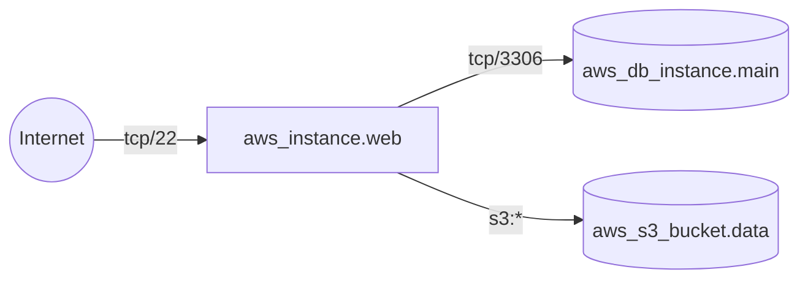
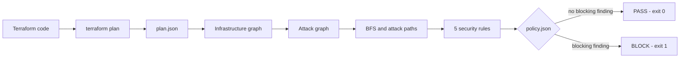
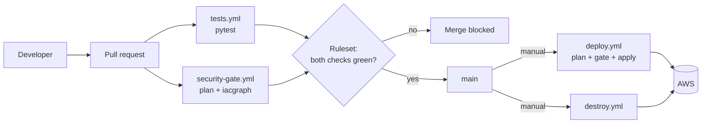

# iacgraph

**A DevSecOps security gate that finds attack paths in Terraform plans for AWS — before the infrastructure exists.**

[](https://github.com/BlertinH/DevSecOps-Cloud-analyzer/actions/workflows/tests.yml)


Most IaC scanners check every resource on its own: *"this security group allows 0.0.0.0/0"*.
Real risk usually comes from a **combination** of resources. iacgraph turns the Terraform plan into a graph and answers one question:

> **What can an attacker on the Internet reach, and through which path?**

It runs in GitHub Actions on every pull request and **blocks the merge** when a change is insecure.

---

## Contents

- [Why a graph?](#why-a-graph)
- [How it works](#how-it-works)
- [Quick start](#quick-start)
- [Using it on your own Terraform code](#using-it-on-your-own-terraform-code)
- [CI/CD](#cicd)
- [Evaluation](#evaluation)
- [Repository structure](#repository-structure)
- [Limitations](#limitations)
- [About](#about)

---

## Why a graph?

Each of these settings looks acceptable on its own. Together they form an attack path to the data:



- the security group opens SSH to `0.0.0.0/0`,
- the server has a public IP and a route to the Internet Gateway,
- the database accepts MySQL from the server,
- the server's IAM role allows `s3:*` on the bucket.

iacgraph reports the open port **and** the two paths that lead from the Internet to the database and to the bucket.

---

## How it works



1. **Read the plan.** Resources and the references between them come from `terraform show -json`.
2. **Infrastructure graph.** Every resource is a node and every reference is an edge (NetworkX `MultiDiGraph`).
3. **Attack graph.** A special `internet` node, plus an edge when:
   - **Internet → server:** the server has a public IP, its subnet routes `0.0.0.0/0` to an Internet Gateway, and an ingress rule is open to the Internet;
   - **server → server or database:** security group rules allow the traffic inside the VPC (lateral movement);
   - **server → S3 bucket:** instance profile → IAM role → policy allows actions on the bucket.
4. **Search.** Breadth-first search (BFS) gives the minimum number of steps from the Internet to every resource. Simple-path search lists the concrete attack paths.
5. **Rules.** Configuration findings that lie on an attack path are raised in severity.
6. **Gate.** The policy decides PASS or BLOCK, and the exit code tells the CI pipeline.

### Rules

| Rule | Finds | Severity |
|---|---|---|
| `NET-01` | SSH (22) or RDP (3389) of a server reachable from the Internet | high |
| `NET-02` | A database reachable directly from the Internet | critical |
| `PATH-01` | A database or S3 bucket reachable through an attack path (2 or more steps) | high |
| `CFG-01` | RDS storage not encrypted | medium → **high** on an attack path |
| `CFG-02` | IAM policy that allows `*` or `<service>:*` | medium → **high** on an attack path |

### Exit codes

| Code | Result | Meaning |
|---|---|---|
| `0` | PASS | no finding at or above `fail_on` |
| `1` | BLOCK | at least one finding at or above `fail_on` |
| `2` | ERROR | the plan or the policy could not be read — the gate **fails closed** |

When a value is only known after `apply`, iacgraph assumes the dangerous case. It may raise a false alarm, but it does not miss a real risk.

---

## Quick start

**Requirements:** Python 3.10+. Terraform 1.11+ only if you want to create your own plans.

```bash
git clone https://github.com/BlertinH/DevSecOps-Cloud-analyzer.git
cd DevSecOps-Cloud-analyzer
python3 -m venv .venv
source .venv/bin/activate
pip install -e ".[dev]"

python -m pytest          # 77 tests
```

Analyse the saved demo plans — no AWS account needed:

```bash
iacgraph tests/fixtures/demo-insecure.plan.json --policy terraform/demo-insecure/policy.json   # BLOCK
iacgraph tests/fixtures/demo-secure.plan.json   --policy terraform/demo-secure/policy.json     # PASS
```

<details>
<summary>Example output (demo-insecure)</summary>

```
Attack paths: 2
  AP-1  internet -[tcp/22]-> aws_instance.web -[tcp/3306]-> aws_db_instance.main
  AP-2  internet -[tcp/22]-> aws_instance.web -[s3:*]-> aws_s3_bucket.data

Findings: 5
  [HIGH] CFG-01  aws_db_instance.main  (raised: on an attack path)
  [HIGH] CFG-02  aws_iam_role_policy.app_s3  (raised: on an attack path)
  [HIGH] NET-01  aws_vpc_security_group_ingress_rule.web_ssh_world
  [HIGH] PATH-01  aws_db_instance.main
  [HIGH] PATH-01  aws_s3_bucket.data

Gate: BLOCK (5 finding(s) at or above high)
```

</details>

---

## Using it on your own Terraform code

```bash
cd my-infrastructure
terraform init
terraform plan -out=tfplan
terraform show -json tfplan > plan.json
iacgraph plan.json --policy policy.json
```

| Option | Description |
|---|---|
| `--policy FILE` | the policy file (without it: `fail_on: high`, no accepted services) |
| `--format text\|json\|sarif` | report format (default: `text`) |
| `--output FILE` | write the report to a file instead of the screen |
| `--source-dir DIR` | folder with the `.tf` files, used for SARIF line numbers |

### The policy (`policy.json`)

```json
{
  "fail_on": "high",
  "accepted_public_services": [
    {"resource": "aws_instance.web", "port": 443}
  ]
}
```

- **`fail_on`** — block the change if a finding is this severe or worse.
- **`accepted_public_services`** — intended exposure, for example a web server that must accept HTTPS from everyone. An accepted service is never used as the entry point of an attack path.

---

## CI/CD



| Workflow | Runs on | What it does |
|---|---|---|
| `tests.yml` (job `pytest`) | every pull request, push to `main` | installs the package and runs the tests |
| `security-gate.yml` (job `iacgraph`) | every pull request | read-only OIDC role → `terraform plan` of `terraform/demo-secure` → iacgraph → PASS/BLOCK |
| `deploy.yml` | manual, `main` only | deploy OIDC role → plan → **gate again** → `terraform apply` |
| `destroy.yml` | manual, `main` only | `terraform destroy` of the demo |

**Security of the pipeline**

- A **ruleset** on `main` requires a pull request and both checks (`pytest`, `iacgraph`). The bypass list is empty.
- **No AWS keys are stored in GitHub.** Workflows get temporary credentials through **OpenID Connect**:
  - `iacgraph-ci-plan` — only for pull requests: `ReadOnlyAccess` plus the state lock file;
  - `iacgraph-ci-deploy` — only for the `main` branch: deploys the demo.
- Terraform state lives in S3 (versioned, encrypted, public access blocked) with a lock file.
- Configuration is stored as repository **variables**, not secrets: `AWS_REGION`, `TF_STATE_BUCKET`, `AWS_PLAN_ROLE_ARN`, `AWS_DEPLOY_ROLE_ARN`, `DEMO_BUCKET_SUFFIX`.

**Set it up in your own AWS account:** apply `terraform/bootstrap` once with an admin user, then create the repository variables from its outputs. Deploy only through `deploy.yml`, and run `destroy.yml` right after testing to avoid costs.

---

## Evaluation

| Research question | Script | Result |
|---|---|---|
| **Accuracy** | `python evaluation/accuracy.py` | **28 / 28** expected findings, 0 false positives, correct gate decision in **7 / 7** scenarios |
| **Comparison with Checkov** | `CHECKOV=/path/to/checkov python evaluation/checkov_compare.py` | iacgraph **25 / 25**; Checkov 15 / 25 with 2 false alarms and none of the attack paths |
| **Performance** | `python evaluation/timing.py` | about 1 ms per scenario; about **3 s for 15,500 resources** |

- The expected findings (ground truth) are in `evaluation/expected.json`, and the detailed results in `evaluation/*.md`.
- The scenario plans in `tests/fixtures/` were created from `terraform/scenarios/` with a mock provider, so no AWS account is needed.
- Checkov and iacgraph complement each other: Checkov covers hundreds of hardening checks per resource, iacgraph covers reachability and attack paths.

---

## Repository structure

```
src/iacgraph/          the tool
  plan.py              read the plan: resources and references
  graph.py             build the infrastructure graph
  network.py           firewall rules, public IPs, routing, network edges
  iam.py               server → instance profile → role → policy → S3
  paths.py             attack graph, BFS, attack paths
  rules.py             the 5 rules and the severity raise
  policy.py            policy.json and the PASS/BLOCK decision
  report.py            text, JSON and SARIF reports
  cli.py               the iacgraph command and its exit codes
tests/                 77 tests and saved plans (tests/fixtures/*.plan.json)
terraform/
  bootstrap/           state bucket, OIDC roles for GitHub, budget (applied once by an admin)
  demo-secure/         the demo infrastructure that the pipeline deploys
  demo-insecure/       the same demo with insecure settings (used to show BLOCK)
  scenarios/           evaluation infrastructures (mock provider, never deployed)
evaluation/            ground truth and evaluation scripts
.github/workflows/     CI/CD
```

---

## Limitations

- **Services:** EC2 servers, RDS databases and S3 buckets are modelled. Load balancers, Auto Scaling, Lambda and containers are not yet.
- **IAM:** only `Allow` statements are evaluated (no `Deny`, SCPs, bucket policies or permission boundaries), so access may be over-reported, never under-reported.
- **Network:** no Network ACLs, VPC peering, Transit Gateway or VPC endpoints.
- **Modules:** only the root Terraform module is analysed.
- **Static analysis:** the tool checks the plan, not the live state of the AWS account.

**Security notes:** never commit `terraform.tfstate` or `terraform.tfvars`. Values marked `sensitive` are still stored in plain text in the Terraform state, so keep the state in an encrypted backend.

---

## About

Bachelor thesis — *"Zhvillimi dhe vlerësimi i një sistemi DevSecOps për detektimin e konfigurimeve të pasigurta në infrastrukturën cloud duke përdorur algoritme të grafeve"*

**Author:** Blertin Hamza · **Mentor:** Prof. Dr. Avni Rexhepi
University of Prishtina "Hasan Prishtina", Faculty of Electrical and Computer Engineering (FIEK), 2026